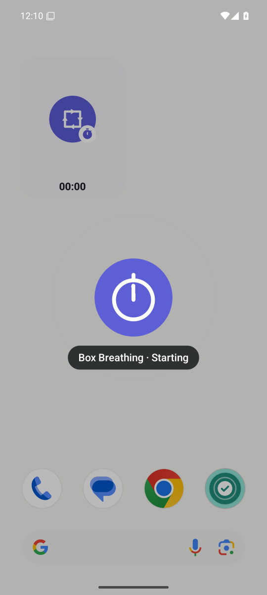
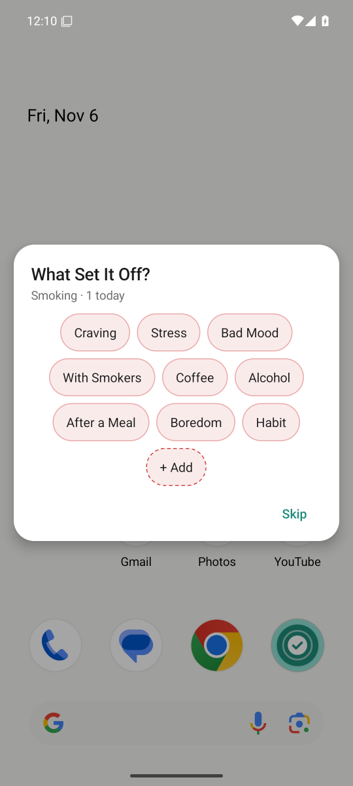
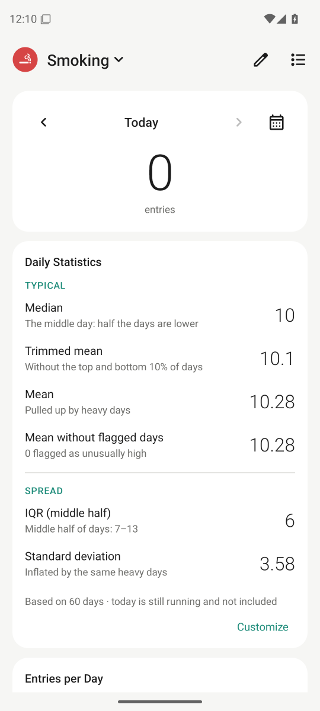
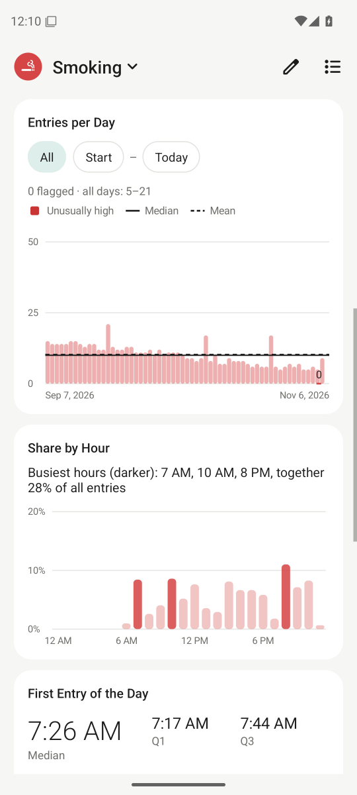
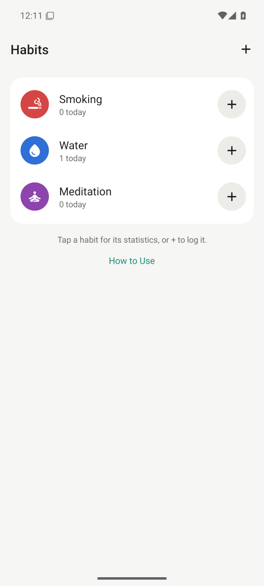
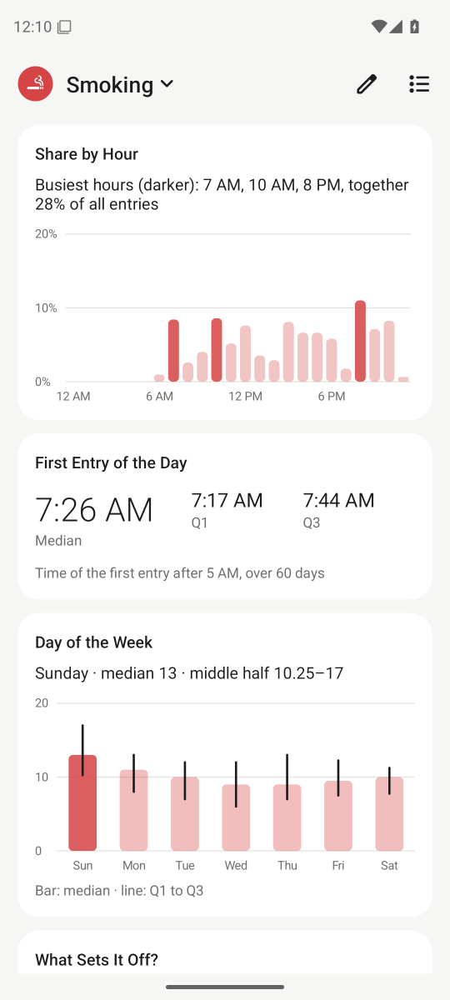
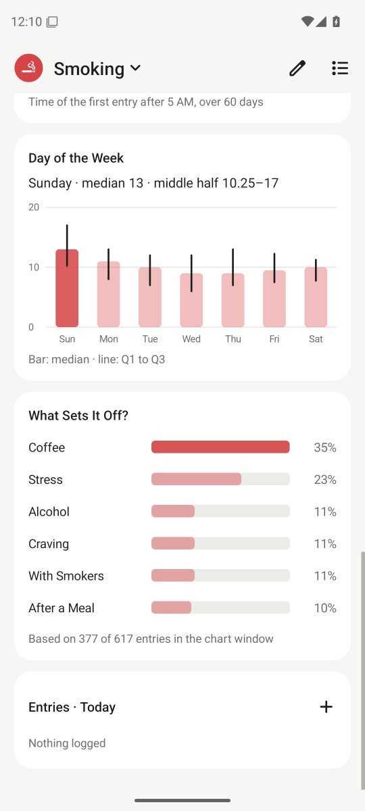
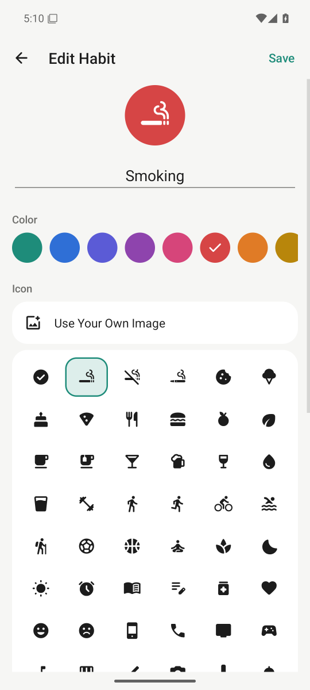
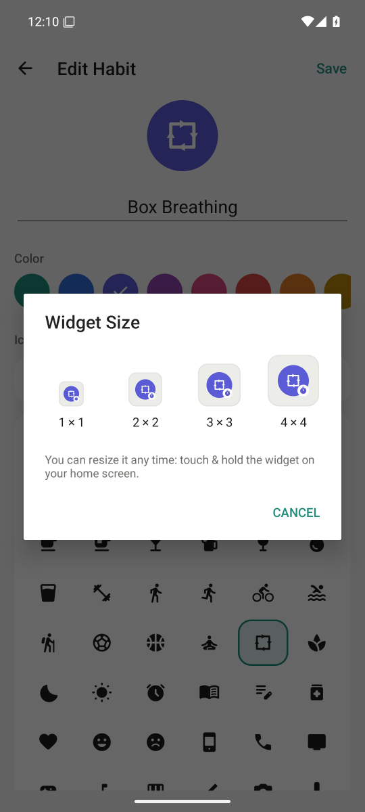
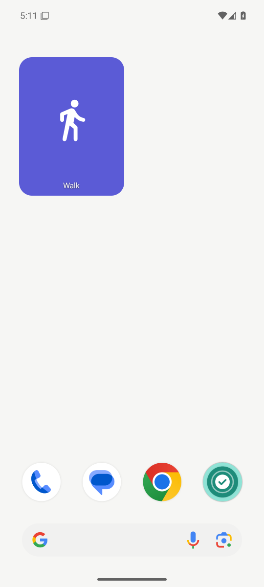

# Habit Tracker

**Tap a widget to count a habit, without leaving your home screen.**

A minimalist Android app. Each habit you track (smoking, water, walks, sleep,
meditation…) gets its own home-screen widget. Tap it and a timestamp is recorded,
confirmed by a short animation in the middle of the screen that shows the habit and
today's count, and you stay where you were.
The Habit Tracker app icon opens the app: your habits and their statistics.

[](https://github.com/MendyAr/habit-tracker/actions/workflows/ci.yml)
[](https://github.com/MendyAr/habit-tracker/releases/latest)

[](LICENSE)

| Tap the widget: logged in place | What set it off? | Daily statistics | Unusual days & history | Your habits |
| :---: | :---: | :---: | :---: | :---: |
|  |  |  |  |  |

| When & first entry | Weekdays & triggers | Make it yours | Widget: pick a size | …a widget that blends in |
| :---: | :---: | :---: | :---: | :---: |
|  |  |  |  |  |

<sub>Screenshots are taken automatically by the instrumented tests on an Android 15 emulator.</sub>

## Download

Get **`HabitTracker-vX.Y.Z.apk`** from the
[latest release](https://github.com/MendyAr/habit-tracker/releases/latest)
and open it on your phone. Allow your browser or file manager to *install unknown
apps* if Android asks. It runs on **Android 5.0 (2014) and newer** and is ready to
use right after installation, with no account, setup or permissions.

To update, install the newer APK over the old one; your data stays.

## How to use

| Do this | To |
| --- | --- |
| **Tap** the Habit Tracker app icon | Open the app: the list of your habits, or the statistics of your only habit. The app icon never logs anything by itself. |
| In the list, **+** at the top | Add a habit: name it, pick an icon and a colour. Tap a habit for its statistics, or its own **+** to log it. |
| **Long-press** the app icon | Jump to *New Habit* or to a habit's statistics (Android 7.1+). |
| In a habit's settings → *Add One-Tap Widget* | Give the habit its own widget (the app offers it right after you create a habit). **Tapping it logs that habit**: a check pops up with today's count, and you stay on your home screen. Pick its size (1 × 1 to 4 × 4), confirm, and you're taken to the home screen to see it. Touch & hold it to resize it any time. Each habit can have one; if it's already there, the app says so. |
| Your launcher's widget list → *Habit Tracker* | The same widget, placed by hand (the only way before Android 8): it asks which habit to show. |

Widgets are a soft, see-through panel that sits well on any wallpaper (on Android
12 and newer in your phone's wallpaper colours, and dark in the dark theme), with
the habit's icon in its colour.

Habit icons pinned to the home screen by earlier versions keep working, but the
app no longer creates new ones: widgets do everything icons did, and more.

The first time you open the app, a short tutorial shows the basics (skip it any
time, or replay it from *How to Use* at the bottom of the habit list).

### What sets it off?

After you log a count habit (from its widget or with **+** in the app), the
confirmation is followed by a card in the middle of the screen: **What Set It Off?**
Tap a trigger (Craving, Stress, Bad Mood, With Smokers, Coffee, Alcohol, After a
Meal, Boredom, Habit) to tag the entry, or **+ Add** to type your own; it's offered
from then on. It is only a suggestion: the entry is already logged, and *Skip*, a
tap outside the card or simply ignoring it leaves it untagged.

In a habit's settings, *Triggers* turns the suggestion off or edits the list
(remove, move up, add). The statistics show **What Sets It Off?**: the share of each
trigger. You can also set or change the trigger of an entry in the *Entries* list.

### Duration trackers

Some habits are about *how long*, not *how often*: for example **Box Breathing**,
where you want to see how long it takes you to calm down. When you add a habit,
choose **Duration** instead of **Count**:

- **Tap its widget to start**: a stopwatch sweeps round (*Box Breathing ·
  Starting*). **Tap again when you're done**: a check shows *Box Breathing · Ended*
  with the time it took, large, below it (**4:32**).
- Double taps are safe: a tap within 3 seconds of the start shows *Already
  Started*, and a tap within 3 seconds of the end shows *Already Ended* with the
  same time. After that, a tap starts a new session.
- Its widget carries a small **stopwatch badge**, and while a session runs it
  **counts up live** in place of the name.
- Forgot to stop it? A tap on a session that has run for hours asks whether to
  **finish it now or discard it**. In the
  statistics you can also tap a running session to finish or discard it, or add a
  session by hand.
- Its statistics describe the session lengths: the median, the mean, the middle
  half (IQR) and the share under a target (5 minutes unless you set another). The
  **Time per Session** chart shows each session, the median of the last 7 (is it
  getting faster?) and the target.

There is a built-in **Box breathing** icon (a square with an arrow on each side).

### Statistics

By default the statistics screen shows the set from the research on what helps
most when tracking a habit like smoking (see the [statistics guide](docs/STATISTICS.md)):

- **Count card**: the number of logs today (or this week/month/year). Use the
  arrows or the calendar to see any other day or period.
- **Daily statistics**, in groups with a short note under each value: *Typical*
  (median, trimmed mean, mean, mean without flagged days) and *Spread* (IQR,
  standard deviation). These hold up when a few days are unusual (a party night),
  unlike the plain mean, which is shown next to them with what pulls it up. Periods
  with zero logs count as 0, and the period still in progress is left out.
- **Entries per Day**: one bar per day; unusually high days are red, with lines at
  the median and the mean. By default it spans all your data; tap the start or end
  date to narrow it (every card uses that window), or *All* to reset. Tap or drag
  across the bars to inspect one, which also selects it in the count card.
- **Share by Hour**: the share of all your entries in each hour, the three busiest
  darker. Touch a bar to read it.
- **First Entry of the Day**: the median time of your first entry, with Q1 and Q3.
  For smoking, a later first cigarette is one of the clearest signs of progress.
- **Day of the Week**: the median of each weekday with its middle half.
- **Entries**: the individual timestamps of the selected period. Tap **+** to add
  one you forgot, or tap an entry to delete an accidental tap.

**Tap a value or a card's title** for a short explanation. **Customize** (on the
statistics card) chooses the period everything is grouped by (day, week, month or
year), adds statistics (range, usual first and last entry, time since the last one,
change against the previous 7 days, total, a target and more) and cards (such as
the [Time of Day curve](#how-time-of-day-is-calculated)), per habit.

### Making each habit your own

Open a habit's settings (the pencil on its statistics, or tap it in *Habits*):

- **Name**, e.g. "Smoking tracker".
- **Icon**: 66 built-in icons (cigarette, no-smoking, box breathing, sweets, food, coffee, water,
  workout, walk, run, cycling, sleep, wake up, meditation, reading, medication,
  …), or **your own image** from the gallery: tap *Use Your Own Image* above the
  icons. Change or remove it the same way.
- **Colour**: ten accents.
- **Clear All Entries**: deletes the habit's timestamps (after asking), keeping the habit.
- **Delete Habit**: removes it and its entries. Android doesn't let apps remove
  home-screen items, so its icon is greyed out and its widget shows *Habit Deleted*
  until you long-press them and choose *Remove*.

Renaming or re-iconing a habit updates its widget (and any older home-screen icon) too.

### How Time of Day is calculated

For every day in the window, each entry draws a bell curve of height 1 centred on
its time of day: it counts fully at its own minute, half about 25 minutes away and
hardly at all beyond an hour. Curves of the same day combine as "at least one entry
around this time" (`1 − (1 − a)(1 − b)…`), so ten entries in one evening still count
as one day, and the result never exceeds 100%. The chart is the average of these
daily curves over all days of the window, including days without entries, so its
height is the share of days on which you logged around that time. It wraps around
midnight, and today is left out until it is over (unless it is the only day).

This is a histogram of the time of day divided by the number of days, smoothed
with a bell curve; the two adjustments (a curve of height 1 rather than of area 1,
and counting each day at most once) keep "every day at 8:00" at exactly 100%.

## Good to know

- **Double taps**: logging the same habit again within a minute asks *Log Again?*
  first. Choose *Don't Ask Again* for habits you really do log in quick succession.
  While the confirmation shows, tapping the widget again counts as a tap; tapping
  anywhere else closes the confirmation.
- **"Can a new widget open in resize mode?"** Android gives apps no way to open
  the launcher's resize handles, which is why the app asks for the size first.
  Some launchers show the handles by themselves when you place a widget by hand:
  touch & hold its preview in the launcher's dialog and drop it where you want it,
  instead of tapping *Add*.
- **"Does anything open when I tap?"** To show the confirmation in the middle of
  the screen, a widget tap starts a window. Habit Tracker's window is completely
  transparent, has no open or close animation, and closes itself after the
  confirmation, so you only ever see your home screen.
- **Why doesn't the app icon log?** So that nothing is ever logged without you
  meaning it: opening the app (also from the installer's *Open* button after an
  update) never records anything. Each habit's own icon or widget does the logging,
  and those can carry the habit's name and icon.
- **"Covariance"**: for a single series, covariance with itself is the variance.
  Add *Variance* and *Std. dev.* in *Customize*.
- **Privacy**: no internet permission, no ads, no analytics. Everything stays on
  your phone and is included in Android's backup and phone-to-phone transfer.

## Building from source

Requirements: JDK 17 and the Android SDK (API 35). Then:

```sh
./gradlew assembleDebug            # app/build/outputs/apk/debug/app-debug.apk
./gradlew :core:test :app:testDebugUnitTest   # JVM + Robolectric tests
./gradlew :app:lintDebug
./gradlew :app:connectedDebugAndroidTest      # on a connected device/emulator
```

`./gradlew assembleRelease` produces a minified APK signed with the repository's
sideload key; see [docs/RELEASING.md](docs/RELEASING.md) for releases and
signing with your own key.

## Project layout

```
core/   pure Kotlin: periods, bucketing, statistics (JVM unit tests)
app/    the Android app (framework only, no runtime libraries)
docs/   architecture and release notes
tools/  scripts that import the icon set and render the legacy launcher icons
```

The design, data model and test strategy are described in
[docs/ARCHITECTURE.md](docs/ARCHITECTURE.md). Changes are listed in the
[changelog](CHANGELOG.md).

## Continuous integration

Every push builds the app, runs the unit and Robolectric tests and Android
lint, uploads the APKs as a build artifact, and runs the instrumented tests on
emulators with **Android 5.0, 10 and 15**. When the default branch carries a
new version number and CI is green, a GitHub release with the signed APK is
published automatically.

## License

[MIT](LICENSE). Icons are [Material Symbols](https://github.com/google/material-design-icons)
by Google, Apache License 2.0 (see [NOTICE](NOTICE)).
